# Modelo de Classes — Plataforma SaaS

> **Status:** baseline v2, revisado em 2026-11-10 conforme `docs/diretrizes.md`.
> **Escopo:** modelo de domínio completo da plataforma (multi-tenant), incluindo entidades já existentes e as novas.
> **Convenção:** entidades de negócio carregam `TenantId`; agregados protegem invariantes por métodos de domínio, não por setters públicos.
> **Identidade:** não existe identidade global de usuário. Cada tenant tem seus próprios cadastros (diretrizes §3.1).

---

## 1. Visão por contexto delimitado (bounded context)

| Contexto | Responsabilidade | Agregados principais |
| --- | --- | --- |
| **Plataforma** | Tenants, planos, assinatura do SaaS, faturamento da plataforma, consumo tarifado | `Tenant`, `Plan`, `Subscription`, `PlatformInvoice`, `UsageQuota`, `CreditPurchase` |
| **Identidade e Acesso** | Usuários, papéis, permissões, sessões | `User`, `Role`, `Permission`, `RefreshToken`, `Invitation` |
| **Catálogo** | Serviços, categorias, combos, vínculo com profissionais | `Service`, `ServiceCategory`, `ServiceVariant`, `ServiceCombo` |
| **Equipe** | Profissionais, jornada, bloqueios, vínculo com serviços | `Professional`, `WorkSchedule`, `ScheduleBlock`, `ProfessionalService` |
| **Agendamento** | Disponibilidade, reservas, estados do atendimento, concorrência | `Appointment`, `AvailabilitySlot`, `WaitlistEntry`, `ScheduleLock` |
| **Clientes** | Cadastro, histórico, preferências, consentimento | `Customer`, `CustomerPreference`, `ConsentRecord` |
| **Financeiro** | Pagamentos, receitas, despesas, comissões — **domínio independente do billing** | `Payment`, `Transaction`, `CommissionRule`, `CommissionEntry` |
| **Assinaturas do negócio** | Clubes, pacotes, benefícios | `MembershipPlan`, `Membership`, `ServicePackage`, `PackageUsage` |
| **Site e Conteúdo** | Site por tenant, páginas, seções, publicação | `Site`, `SitePage`, `SiteSection`, `SitePublication` |
| **IA** | Geração e personalização de site, guardrails, cobrança de alteração | `AiGenerationRequest`, `AiChangeSet`, `AiOperationLog`, `SiteChangeCharge` |
| **Comunicação** | Notificações, templates, conversas WhatsApp | `Notification`, `MessageTemplate`, `Conversation`, `Message` |
| **Auditoria** | Registro imutável de ações sensíveis | `AuditEntry` |

---

## 2. Classes por contexto

### 2.1. Contexto Plataforma

#### `Tenant`
Agregado raiz do estabelecimento. Todo dado de negócio pertence a um tenant.

| Membro | Tipo | Descrição |
| --- | --- | --- |
| `Id` | `Guid` | Identificador |
| `Slug` | `string` | Identificador único usado no subdomínio |
| `Name` | `string` | Nome do estabelecimento |
| `Segment` | `SegmentType` | Segmento de atuação |
| `Document` | `string` | CNPJ ou CPF do responsável |
| `Status` | `TenantStatus` | `Trial`, `Active`, `Suspended`, `Cancelled` |
| `CreatedAt` | `DateTimeOffset` | Data de criação |
| `Subscription` | `Subscription` | Assinatura vigente |
| `EnabledModules` | `IReadOnlyCollection<ModuleType>` | Módulos habilitados |

Métodos: `Activate()`, `Suspend(reason)`, `Cancel()`, `EnableModule(module)`, `DisableModule(module)`, `IsModuleEnabled(module)`.

Invariantes: `Slug` imutável após publicação do site; não é possível desabilitar módulo com contrato ativo em uso.

#### `Plan`
Plano comercial da plataforma.

| Membro | Tipo |
| --- | --- |
| `Id` | `Guid` |
| `Code` | `string` |
| `Name` | `string` |
| `MonthlyPrice` | `Money` |
| `IncludedProfessionals` | `int` |
| `SiteCustomizationLevel` | `SiteCustomizationLevel` |
| `IncludedAiUnits` | `int` |
| `IncludedModules` | `IReadOnlyCollection<ModuleType>` |
| `IsActive` | `bool` |

Métodos: `AllowsProfessionals(count)`, `AllowsCustomization(level)`, `AiAllowance()`.

Invariantes: **não existe preço por profissional excedente** — ao ultrapassar `IncludedProfessionals`, o tenant precisa subir de plano (diretrizes §8.2 / decisão D9). Todos os planos incluem todos os módulos; a diferenciação é quantidade de profissionais, grau de personalização do site e **franquia mensal de IA**. A franquia de WhatsApp **não** é do plano: o consumo é tarifado e a franquia gratuita vem da Meta.

#### `Subscription`
Assinatura de um tenant a um plano.

| Membro | Tipo |
| --- | --- |
| `Id` | `Guid` |
| `TenantId` | `Guid` |
| `PlanId` | `Guid` |
| `Status` | `SubscriptionStatus` |
| `CurrentPeriodStart` / `CurrentPeriodEnd` | `DateOnly` |
| `TrialEndsAt` | `DateOnly?` |
| `GatewayCustomerId` | `string?` |
| `GatewaySubscriptionId` | `string?` |

Métodos: `StartTrial(days)`, `Renew(period)`, `MarkPastDue()`, `Cancel(atPeriodEnd)`.

#### `PlatformInvoice`
Fatura da plataforma contra o tenant.

| Membro | Tipo |
| --- | --- |
| `Id` | `Guid` |
| `SubscriptionId` | `Guid` |
| `Amount` | `Money` |
| `DueDate` | `DateOnly` |
| `Status` | `InvoiceStatus` |
| `PaidAt` | `DateTimeOffset?` |
| `GatewayPaymentId` | `string?` |

Métodos: `MarkPaid(gatewayPaymentId)`, `MarkFailed(reason)`, `IsOverdue(now)`.

#### `PlanChange`
Registro imutável de uma mudança de plano do tenant (F16.5).

| Membro | Tipo | Descrição |
| --- | --- | --- |
| `Id` | `Guid` | |
| `TenantId` | `Guid` | |
| `SubscriptionId` | `Guid` | |
| `FromPlanId` | `Guid?` | Nulo na contratação inicial |
| `ToPlanId` | `Guid` | Plano escolhido |
| `Reason` | `PlanChangeReason` | `Initial`, `Upgrade`, `Downgrade`, `ForcedUpgrade` |
| `ChangedAt` | `DateTimeOffset` | Momento da mudança |
| `ChangedBy` | `Guid` | Usuário que solicitou |

Métodos: `Record(tenantId, subscriptionId, fromPlanId, toPlanId, reason, changedBy, now)`.

Invariantes: imutável após criação; `FromPlanId` nulo apenas quando `Reason = Initial`; `ForcedUpgrade` ocorre quando o tenant ultrapassa a faixa de profissionais do plano.

#### `UsageQuota`
Cota de consumo de um recurso medido, por tenant e por período de faturamento.

| Membro | Tipo | Descrição |
| --- | --- | --- |
| `Id` | `Guid` | |
| `TenantId` | `Guid` | |
| `Resource` | `QuotaResource` | WhatsApp ou IA |
| `PeriodStart` / `PeriodEnd` | `DateOnly` | Período de faturamento |
| `Included` | `int` | Franquia do período |
| `Consumed` | `int` | Consumo acumulado |
| `PurchasedExtra` | `int` | Créditos comprados antecipadamente |
| `TenantLimit` | `int?` | Teto definido pelo estabelecimento |
| `BillingMode` | `ConsumptionBillingMode` | Automática ou créditos |

Métodos: `TryConsume(quantity)`, `Remaining()`, `AddExtra(quantity)`, `SetTenantLimit(limit)`, `Reset(period)`.

Invariantes:

- `TryConsume` retorna falso quando `Consumed + quantity > Included + PurchasedExtra` **ou** quando ultrapassa `TenantLimit`.
- O consumo nunca ultrapassa o limite sem autorização (diretrizes §7.1).
- Para WhatsApp, `Included` reflete a **franquia gratuita da Meta repassada ao tenant** — não há subsídio de mensagens com custo.
- Para IA, `Included` é a **franquia mensal do plano**; o excedente é cobrado adicionalmente.
- Os dois recursos são contabilizados e cobrados **separadamente**.

#### `ConsumptionBillingMode` (enum)
`Automatic`, `PrepaidCredits` — modalidade escolhida pelo estabelecimento para o WhatsApp.

#### `CreditPurchase`
Compra antecipada de créditos de consumo.

| Membro | Tipo |
| --- | --- |
| `Id` | `Guid` |
| `TenantId` | `Guid` |
| `Resource` | `QuotaResource` |
| `Quantity` | `int` |
| `Amount` | `Money` |
| `PurchasedAt` | `DateTimeOffset` |
| `PlatformInvoiceId` | `Guid?` |

Métodos: `MarkPaid(invoiceId)`, `ApplyTo(quota)`.

Invariantes: créditos só são aplicados à cota após o pagamento confirmado.

#### `QuotaResource` (enum)
`WhatsAppMessages`, `AiUnits`. Os dois recursos têm franquias e cobranças independentes.

#### `SiteCustomizationLevel` (enum)
`Basic`, `Intermediate`, `Advanced`, `Full` — grau de personalização do site permitido pelo plano.

#### `ModuleType` (enum)
`Membership`, `Packages`, `Commissions`, `WhatsAppAutomation`, `Loyalty`, `AiSiteBuilder`, `OnlinePayments`.

#### `SegmentType` (enum)
`Barbershop`, `HairSalon`, `NailStudio`, `Aesthetics`, `BrowsAndLashes`, `Tattoo`, `Massage`, `Makeup`, `Waxing`, `Braids`, `Other`.

#### `TenantStatus` / `SubscriptionStatus` / `InvoiceStatus` (enums)
Estados de ciclo de vida do tenant, da assinatura e da fatura.

---

### 2.2. Contexto Identidade e Acesso

#### `User`
Usuário **de um tenant**. Pode ser membro da equipe ou cliente final.

| Membro | Tipo | Descrição |
| --- | --- | --- |
| `Id` | `Guid` | |
| `TenantId` | `Guid?` | Nulo **apenas** para administradores da plataforma |
| `Name` | `string` | |
| `Email` | `string` | Único **por tenant** |
| `Phone` | `string?` | |
| `PasswordHash` | `string` | |
| `Role` | `Role` | Papel dentro do tenant |
| `IsActive` | `bool` | |
| `LastLoginAt` | `DateTimeOffset?` | |

Métodos: `ChangePassword(newHash)`, `Deactivate()`, `Activate()`, `UpdateProfile(...)`.

Invariantes: **não existe identidade global de usuário** (diretrizes §3.1). A mesma pessoa física que frequenta dois estabelecimentos possui dois registros `User` independentes, sem vínculo, sem e-mail compartilhado e sem qualquer relacionamento automático entre eles. O e-mail é único dentro do tenant, não globalmente.

#### `Role` (enum)
`PlatformAdmin`, `Owner`, `Administrator`, `Professional`, `Receptionist`, `Customer`.

#### `Permission`
Permissão granular associada a um papel.

| Membro | Tipo |
| --- | --- |
| `Id` | `Guid` |
| `Code` | `string` |
| `Description` | `string` |

#### `RefreshToken`
Token de renovação de sessão.

| Membro | Tipo |
| --- | --- |
| `Id` | `Guid` |
| `UserId` | `Guid` |
| `TokenHash` | `string` |
| `ExpiresAt` | `DateTimeOffset` |
| `RevokedAt` | `DateTimeOffset?` |

Métodos: `Revoke()`, `IsValid(now)`.

#### `Invitation`
Convite de membro da equipe.

| Membro | Tipo |
| --- | --- |
| `Id` | `Guid` |
| `TenantId` | `Guid` |
| `Email` | `string` |
| `Role` | `Role` |
| `TokenHash` | `string` |
| `ExpiresAt` | `DateTimeOffset` |
| `AcceptedAt` | `DateTimeOffset?` |

Métodos: `Accept(userId)`, `Expire()`, `IsValid(now)`.

---

### 2.3. Contexto Catálogo

#### `Service`
Serviço oferecido pelo tenant. Evolui da entidade atual.

| Membro | Tipo |
| --- | --- |
| `Id` | `Guid` |
| `TenantId` | `Guid` |
| `CategoryId` | `Guid?` |
| `Name` | `string` |
| `Description` | `string?` |
| `Price` | `Money` |
| `DurationMinutes` | `int` |
| `Highlight` | `bool` |
| `IsActive` | `bool` |

Métodos: `Update(...)`, `Deactivate()`, `Activate()`, `ChangePrice(money)`.

Invariantes: `DurationMinutes > 0`; `Price >= 0`; desativação preserva histórico.

#### `ServiceCategory`
| Membro | Tipo |
| --- | --- |
| `Id` | `Guid` |
| `TenantId` | `Guid` |
| `Name` | `string` |
| `SortOrder` | `int` |

#### `ServiceVariant`
Variação de preço/duração por profissional ou por tipo.

| Membro | Tipo |
| --- | --- |
| `Id` | `Guid` |
| `ServiceId` | `Guid` |
| `ProfessionalId` | `Guid?` |
| `Label` | `string` |
| `Price` | `Money` |
| `DurationMinutes` | `int` |

#### `ServiceCombo`
Combinação de serviços executados na mesma sessão.

| Membro | Tipo |
| --- | --- |
| `Id` | `Guid` |
| `TenantId` | `Guid` |
| `Name` | `string` |
| `ComboPrice` | `Money` |
| `Items` | `IReadOnlyCollection<ComboItem>` |

Métodos: `TotalDuration()`, `AddItem(serviceId, quantity)`.

#### `ComboItem`
| Membro | Tipo |
| --- | --- |
| `ServiceId` | `Guid` |
| `Quantity` | `int` |

---

### 2.4. Contexto Equipe

#### `Professional`
Profissional que executa serviços. Substitui `Barber`, generalizando para qualquer segmento.

| Membro | Tipo |
| --- | --- |
| `Id` | `Guid` |
| `TenantId` | `Guid` |
| `UserId` | `Guid?` | Vínculo com usuário de login |
| `Name` | `string` |
| `Title` | `string?` | Cargo exibido |
| `Bio` | `string?` |
| `PhotoUrl` | `string?` |
| `IsActive` | `bool` |
| `Schedule` | `WorkSchedule` |

Métodos: `AssignService(serviceId)`, `RemoveService(serviceId)`, `UpdateSchedule(schedule)`, `Deactivate()`.

#### `WorkSchedule`
Jornada semanal. Evolui de `BarberSchedule`.

| Membro | Tipo |
| --- | --- |
| `WorkDays` | `IReadOnlySet<DayOfWeek>` |
| `StartTime` | `TimeOnly` |
| `EndTime` | `TimeOnly` |
| `SlotIntervalMinutes` | `int` |

Métodos: `WorksOn(date)`, `FitsWithinSchedule(time, duration)`, `GenerateSlots(date, duration)`.

Invariantes: `StartTime < EndTime`; `SlotIntervalMinutes` entre 5 e 120.

#### `ScheduleBlock`
Bloqueio pontual de agenda.

| Membro | Tipo |
| --- | --- |
| `Id` | `Guid` |
| `ProfessionalId` | `Guid` |
| `Start` | `DateTimeOffset` |
| `End` | `DateTimeOffset` |
| `Reason` | `string?` |

Métodos: `Overlaps(start, end)`.

#### `ProfessionalService`
Vínculo N:N entre profissional e serviço.

| Membro | Tipo |
| --- | --- |
| `ProfessionalId` | `Guid` |
| `ServiceId` | `Guid` |

---

### 2.5. Contexto Agendamento

#### `Appointment`
Agregado raiz do atendimento. Mantém as regras de transição de estado já existentes.

| Membro | Tipo |
| --- | --- |
| `Id` | `Guid` |
| `TenantId` | `Guid` |
| `CustomerId` | `Guid` |
| `ProfessionalId` | `Guid` |
| `ServiceId` | `Guid` |
| `Date` | `DateOnly` |
| `Time` | `TimeOnly` |
| `DurationMinutes` | `int` |
| `Status` | `AppointmentStatus` |
| `Notes` | `string?` |
| `RequiresDeposit` | `bool` |
| `DepositPaid` | `bool` |
| `CancellationReason` | `string?` |

Métodos: `Confirm()`, `Cancel(reason)`, `Complete(now)`, `Reschedule(date, time)`, `MarkNoShow()`, `RegisterDeposit(paymentId)`.

Invariantes: só transições a partir de `Confirmed`; `Complete` rejeita data futura; conflito de horário bloqueado no agregado de agenda.

#### `AppointmentStatus` (enum)
`Pending`, `Confirmed`, `Cancelled`, `Completed`, `NoShow`.

#### `ScheduleLock`
Trava de reserva usada para garantir consistência sob concorrência (diretrizes §4.1).

| Membro | Tipo |
| --- | --- |
| `Id` | `Guid` |
| `TenantId` | `Guid` |
| `ProfessionalId` | `Guid` |
| `Date` | `DateOnly` |
| `StartTime` | `TimeOnly` |
| `EndTime` | `TimeOnly` |
| `AppointmentId` | `Guid?` |
| `ExpiresAt` | `DateTimeOffset` |

Métodos: `IsActive(now)`, `Release()`.

Invariantes: existe **no máximo uma** trava ativa por `(TenantId, ProfessionalId, Date, StartTime)` — garantida por índice único parcial no banco. A criação do agendamento adquire a trava dentro de transação; se a trava já existir, a reserva é rejeitada. A trava expira se a transação não concluir, evitando bloqueio permanente.

#### `AvailabilitySlot`
Objeto de valor calculado, não persistido.

| Membro | Tipo |
| --- | --- |
| `Date` | `DateOnly` |
| `Time` | `TimeOnly` |
| `ProfessionalId` | `Guid` |
| `IsAvailable` | `bool` |

#### `WaitlistEntry`
| Membro | Tipo |
| --- | --- |
| `Id` | `Guid` |
| `TenantId` | `Guid` |
| `CustomerId` | `Guid` |
| `ServiceId` | `Guid` |
| `PreferredDate` | `DateOnly` |
| `Status` | `WaitlistStatus` |

Métodos: `Offer(slot)`, `Accept()`, `Expire()`.

---

### 2.6. Contexto Clientes

#### `Customer`
Cliente final do tenant. Separado de `User` porque nem todo cliente tem login.

| Membro | Tipo |
| --- | --- |
| `Id` | `Guid` |
| `TenantId` | `Guid` |
| `UserId` | `Guid?` |
| `Name` | `string` |
| `Phone` | `string` |
| `Email` | `string?` |
| `BirthDate` | `DateOnly?` |
| `Notes` | `string?` |
| `IsActive` | `bool` |
| `CreatedAt` | `DateTimeOffset` |

Métodos: `Anonymize()`, `Deactivate()`, `UpdateContact(...)`.

#### `CustomerPreference`
| Membro | Tipo |
| --- | --- |
| `CustomerId` | `Guid` |
| `PreferredProfessionalId` | `Guid?` |
| `Notes` | `string?` |

#### `ConsentRecord`
Registro de consentimento LGPD.

| Membro | Tipo |
| --- | --- |
| `Id` | `Guid` |
| `CustomerId` | `Guid` |
| `Purpose` | `ConsentPurpose` |
| `Granted` | `bool` |
| `GrantedAt` | `DateTimeOffset` |
| `RevokedAt` | `DateTimeOffset?` |
| `Source` | `string` |

Métodos: `Revoke(now)`.

---

### 2.7. Contexto Financeiro

#### `Payment`
Pagamento de um atendimento ou de uma assinatura do negócio.

| Membro | Tipo |
| --- | --- |
| `Id` | `Guid` |
| `TenantId` | `Guid` |
| `AppointmentId` | `Guid?` |
| `MembershipId` | `Guid?` |
| `Amount` | `Money` |
| `Method` | `PaymentMethod` |
| `Status` | `PaymentStatus` |
| `Gateway` | `GatewayType?` |
| `GatewayPaymentId` | `string?` |
| `PaidAt` | `DateTimeOffset?` |

Métodos: `Confirm(gatewayPaymentId)`, `Fail(reason)`, `Refund(amount, reason)`.

#### `PaymentMethod` (enum)
`Cash`, `CreditCard`, `DebitCard`, `Pix`, `BankTransfer`, `Other`.

#### `PaymentStatus` (enum)
`Pending`, `Paid`, `Failed`, `Refunded`, `PartiallyRefunded`.

#### `Transaction`
Lançamento financeiro do tenant.

| Membro | Tipo |
| --- | --- |
| `Id` | `Guid` |
| `TenantId` | `Guid` |
| `Type` | `TransactionType` |
| `CategoryId` | `Guid?` |
| `Amount` | `Money` |
| `OccurredAt` | `DateTimeOffset` |
| `Description` | `string` |
| `PaymentId` | `Guid?` |

#### `CommissionRule`
| Membro | Tipo |
| --- | --- |
| `Id` | `Guid` |
| `TenantId` | `Guid` |
| `ProfessionalId` | `Guid?` |
| `ServiceId` | `Guid?` |
| `Percentage` | `decimal` |
| `FixedAmount` | `Money?` |

Métodos: `CalculateFor(amount)`.

#### `CommissionEntry`
| Membro | Tipo |
| --- | --- |
| `Id` | `Guid` |
| `TenantId` | `Guid` |
| `ProfessionalId` | `Guid` |
| `AppointmentId` | `Guid` |
| `Amount` | `Money` |
| `ReferencePeriod` | `DateOnly` |
| `Status` | `CommissionStatus` |

---

### 2.8. Contexto Assinaturas do Negócio

#### `MembershipPlan`
Clube de assinatura oferecido pelo tenant.

| Membro | Tipo |
| --- | --- |
| `Id` | `Guid` |
| `TenantId` | `Guid` |
| `Name` | `string` |
| `MonthlyPrice` | `Money` |
| `Benefits` | `IReadOnlyCollection<MembershipBenefit>` |
| `IsActive` | `bool` |

#### `MembershipBenefit`
| Membro | Tipo |
| --- | --- |
| `ServiceId` | `Guid?` |
| `QuantityPerPeriod` | `int` |
| `DiscountPercentage` | `decimal?` |

#### `Membership`
Assinatura de um cliente ao clube.

| Membro | Tipo |
| --- | --- |
| `Id` | `Guid` |
| `TenantId` | `Guid` |
| `CustomerId` | `Guid` |
| `MembershipPlanId` | `Guid` |
| `Status` | `MembershipStatus` |
| `CurrentPeriodStart` / `CurrentPeriodEnd` | `DateOnly` |

Métodos: `Renew()`, `Suspend()`, `Cancel()`, `ConsumeBenefit(serviceId)`.

#### `ServicePackage`
Pacote pré-pago de sessões.

| Membro | Tipo |
| --- | --- |
| `Id` | `Guid` |
| `TenantId` | `Guid` |
| `Name` | `string` |
| `Price` | `Money` |
| `SessionsIncluded` | `int` |
| `ValidityDays` | `int` |

#### `PackageUsage`
| Membro | Tipo |
| --- | --- |
| `Id` | `Guid` |
| `TenantId` | `Guid` |
| `PackageId` | `Guid` |
| `CustomerId` | `Guid` |
| `SessionsRemaining` | `int` |
| `ExpiresAt` | `DateOnly` |

Métodos: `Consume()`, `IsExpired(now)`.

---

### 2.9. Contexto Site e Conteúdo

#### `Site`
Site público de um tenant.

| Membro | Tipo |
| --- | --- |
| `Id` | `Guid` |
| `TenantId` | `Guid` |
| `Subdomain` | `string` |
| `CustomDomain` | `string?` |
| `Theme` | `SiteTheme` |
| `Status` | `SiteStatus` |
| `PublishedVersionId` | `Guid?` |

Métodos: `Publish(versionId)`, `SetCustomDomain(domain)`, `ChangeTheme(theme)`.

#### `SitePage`
| Membro | Tipo |
| --- | --- |
| `Id` | `Guid` |
| `SiteId` | `Guid` |
| `Slug` | `string` |
| `Title` | `string` |
| `SortOrder` | `int` |
| `Sections` | `IReadOnlyCollection<SiteSection>` |

#### `SiteSection`
| Membro | Tipo |
| --- | --- |
| `Id` | `Guid` |
| `PageId` | `Guid` |
| `ComponentType` | `string` |
| `SortOrder` | `int` |
| `Configuration` | `json` |

Métodos: `Reconfigure(configuration)`, `MoveTo(order)`.

#### `SiteTheme`
| Membro | Tipo |
| --- | --- |
| `PrimaryColor` | `string` |
| `SecondaryColor` | `string` |
| `FontFamily` | `string` |
| `LayoutStyle` | `string` |

#### `SitePublication`
Versão publicada do site.

| Membro | Tipo |
| --- | --- |
| `Id` | `Guid` |
| `SiteId` | `Guid` |
| `Version` | `int` |
| `Snapshot` | `json` |
| `PublishedAt` | `DateTimeOffset` |
| `PublishedBy` | `Guid` |

Métodos: `Rollback()`.

---

### 2.10. Contexto IA

#### `AiGenerationRequest`
Solicitação de geração ou alteração de site.

| Membro | Tipo |
| --- | --- |
| `Id` | `Guid` |
| `TenantId` | `Guid` |
| `SiteId` | `Guid` |
| `Kind` | `AiRequestKind` |
| `Prompt` | `string` |
| `References` | `IReadOnlyCollection<string>` |
| `Status` | `AiRequestStatus` |
| `CreatedAt` | `DateTimeOffset` |

#### `AiChangeSet`
Conjunto de alterações propostas pela IA.

| Membro | Tipo |
| --- | --- |
| `Id` | `Guid` |
| `RequestId` | `Guid` |
| `ProposedSnapshot` | `json` |
| `Status` | `ChangeSetStatus` |
| `ApprovedBy` | `Guid?` |
| `ApprovedAt` | `DateTimeOffset?` |

Métodos: `Approve(userId)`, `Reject(reason)`, `IsApproved()`.

Invariantes: nenhuma alteração chega ao site publicado sem `Approve`.

#### `AiOperationLog`
| Membro | Tipo |
| --- | --- |
| `Id` | `Guid` |
| `RequestId` | `Guid` |
| `Model` | `string` |
| `TokensIn` / `TokensOut` | `int` |
| `Cost` | `decimal` |
| `GuardrailViolations` | `json?` |

#### `SiteChangeCharge`
Cobrança avulsa de uma alteração de site solicitada **após a publicação** (diretrizes §6 / ADR-007).

| Membro | Tipo |
| --- | --- |
| `Id` | `Guid` |
| `TenantId` | `Guid` |
| `SiteId` | `Guid` |
| `RequestId` | `Guid` |
| `Amount` | `Money` |
| `Status` | `ChargeStatus` |
| `PlatformInvoiceId` | `Guid?` |

Métodos: `MarkBilled(invoiceId)`, `Waive(reason)`.

Invariantes: a geração inicial e a publicação **não** geram cobrança; apenas alterações posteriores ao lançamento geram `SiteChangeCharge`. A cobrança é registrada **antes** de executar a alteração, com aviso explícito de custo ao tenant.

---

### 2.11. Contexto Comunicação

#### `Notification`
| Membro | Tipo |
| --- | --- |
| `Id` | `Guid` |
| `TenantId` | `Guid` |
| `CustomerId` | `Guid?` |
| `Channel` | `NotificationChannel` |
| `TemplateId` | `Guid?` |
| `Payload` | `json` |
| `Status` | `NotificationStatus` |
| `ScheduledAt` | `DateTimeOffset?` |
| `SentAt` | `DateTimeOffset?` |

Métodos: `Schedule(at)`, `MarkSent()`, `MarkFailed(reason)`.

#### `MessageTemplate`
| Membro | Tipo |
| --- | --- |
| `Id` | `Guid` |
| `TenantId` | `Guid` |
| `Key` | `string` |
| `Channel` | `NotificationChannel` |
| `Body` | `string` |
| `IsActive` | `bool` |

#### `Conversation`
Conversa de WhatsApp com um cliente.

| Membro | Tipo |
| --- | --- |
| `Id` | `Guid` |
| `TenantId` | `Guid` |
| `CustomerId` | `Guid?` |
| `Phone` | `string` |
| `Status` | `ConversationStatus` |
| `AssignedTo` | `Guid?` |

Métodos: `Assign(userId)`, `Close()`, `EscalateToHuman()`.

#### `Message`
| Membro | Tipo |
| --- | --- |
| `Id` | `Guid` |
| `ConversationId` | `Guid` |
| `Direction` | `MessageDirection` |
| `Body` | `string` |
| `SentAt` | `DateTimeOffset` |
| `ExternalId` | `string?` |

---

### 2.12. Contexto Auditoria

#### `AuditEntry`
| Membro | Tipo |
| --- | --- |
| `Id` | `Guid` |
| `TenantId` | `Guid?` |
| `ActorId` | `Guid?` |
| `Action` | `string` |
| `EntityType` | `string` |
| `EntityId` | `Guid` |
| `Changes` | `json` |
| `OccurredAt` | `DateTimeOffset` |
| `IpAddress` | `string?` |

Somente inserção; sem métodos de alteração ou exclusão.

---

## 3. Objetos de valor compartilhados

| Tipo | Membros | Regras |
| --- | --- | --- |
| `Money` | `Amount: decimal`, `Currency: string` | `Amount >= 0`; moeda ISO 4217 |
| `DateRange` | `Start: DateOnly`, `End: DateOnly` | `Start <= End` |
| `TimeRange` | `Start: TimeOnly`, `End: TimeOnly` | `Start < End` |
| `PhoneNumber` | `CountryCode`, `Number` | Normalização E.164 |
| `EmailAddress` | `Value` | Validação de formato |

---

## 4. Interfaces de domínio e aplicação

| Interface | Responsabilidade |
| --- | --- |
| `ITenantScoped` | Marca entidades de negócio que possuem `TenantId`; base do filtro global do EF Core |
| `ITenantContext` | Resolve o tenant da requisição e alimenta o filtro global |
| `ITenantMembershipValidator` | Verifica que o usuário autenticado pertence ao tenant em que tenta atuar (diretrizes §3) |
| `IWhatsAppPartnerGateway` | Abstrai a operação do WhatsApp como Solution Partner da Meta: envio, tarifação e repasse da franquia gratuita |
| `IConsumptionBillingService` | Apura consumo por recurso e gera linhas de cobrança separadas (WhatsApp e IA) |
| `IBookingPolicy` | Política de agendamento por segmento: antecedência, sinal, no-show, cancelamento |
| `IAvailabilityPolicy` | Política de disponibilidade por segmento: granularidade, duração variável, múltiplos blocos |
| `ICommissionPolicy` | Política de cálculo de comissão |
| `IBenefitPolicy` | Política de consumo de clube e pacote |
| `IUsageQuotaService` | Mede e limita consumo por tenant (WhatsApp, alterações de site) |
| `IPaymentGateway` | Abstrai o gateway de pagamento; implementação confirmada: Mercado Pago (cobrança, assinatura, estorno, webhook) |
| `IMessagingProvider` | Abstrai Cloud API da Meta e provedores alternativos |
| `IAiSiteGenerator` | Abstrai o provedor de LLM para geração de site |
| `INotificationSender` | Envio por e-mail, WhatsApp e SMS |
| `IRepository<T>` | Contrato genérico de repositório por agregado |
| `IUnitOfWork` | Transação e commit por caso de uso |
| `IClock` | Abstração de tempo para testes determinísticos |

---

## 5. Diagrama de classes (Mermaid)

```mermaid
classDiagram
    direction LR

    %% ===== PLATAFORMA =====
    class Tenant {
        +Guid Id
        +string Slug
        +string Name
        +SegmentType Segment
        +string Document
        +TenantStatus Status
        +DateTimeOffset CreatedAt
        +Activate()
        +Suspend(reason)
        +Cancel()
        +EnableModule(module)
        +DisableModule(module)
        +IsModuleEnabled(module) bool
    }

    class Plan {
        +Guid Id
        +string Code
        +string Name
        +Money MonthlyPrice
        +int IncludedProfessionals
        +SiteCustomizationLevel SiteCustomizationLevel
        +int IncludedAiUnits
        +bool IsActive
        +AllowsProfessionals(count) bool
        +AllowsCustomization(level) bool
        +AiAllowance() int
    }

    class UsageQuota {
        +Guid Id
        +Guid TenantId
        +QuotaResource Resource
        +DateOnly PeriodStart
        +DateOnly PeriodEnd
        +int Included
        +int Consumed
        +int PurchasedExtra
        +int? TenantLimit
        +ConsumptionBillingMode BillingMode
        +TryConsume(quantity) bool
        +Remaining() int
        +AddExtra(quantity)
        +SetTenantLimit(limit)
        +Reset(period)
    }

    class CreditPurchase {
        +Guid Id
        +Guid TenantId
        +QuotaResource Resource
        +int Quantity
        +Money Amount
        +DateTimeOffset PurchasedAt
        +Guid? PlatformInvoiceId
        +MarkPaid(invoiceId)
        +ApplyTo(quota)
    }

    class Subscription {
        +Guid Id
        +Guid TenantId
        +Guid PlanId
        +SubscriptionStatus Status
        +DateOnly CurrentPeriodStart
        +DateOnly CurrentPeriodEnd
        +DateOnly? TrialEndsAt
        +string? GatewaySubscriptionId
        +StartTrial(days)
        +Renew(period)
        +MarkPastDue()
        +Cancel(atPeriodEnd)
    }

    class PlatformInvoice {
        +Guid Id
        +Guid SubscriptionId
        +Money Amount
        +DateOnly DueDate
        +InvoiceStatus Status
        +DateTimeOffset? PaidAt
        +MarkPaid(gatewayPaymentId)
        +MarkFailed(reason)
        +IsOverdue(now) bool
    }

    %% ===== IDENTIDADE =====
    class User {
        +Guid Id
        +Guid? TenantId
        +string Name
        +string Email
        +string? Phone
        +string PasswordHash
        +Role Role
        +bool IsActive
        +DateTimeOffset? LastLoginAt
        +ChangePassword(newHash)
        +Deactivate()
        +Activate()
        +UpdateProfile()
    }

    class RefreshToken {
        +Guid Id
        +Guid UserId
        +string TokenHash
        +DateTimeOffset ExpiresAt
        +DateTimeOffset? RevokedAt
        +Revoke()
        +IsValid(now) bool
    }

    class Invitation {
        +Guid Id
        +Guid TenantId
        +string Email
        +Role Role
        +string TokenHash
        +DateTimeOffset ExpiresAt
        +DateTimeOffset? AcceptedAt
        +Accept(userId)
        +Expire()
        +IsValid(now) bool
    }

    %% ===== CATÁLOGO =====
    class Service {
        +Guid Id
        +Guid TenantId
        +Guid? CategoryId
        +string Name
        +string? Description
        +Money Price
        +int DurationMinutes
        +bool Highlight
        +bool IsActive
        +Update()
        +Deactivate()
        +Activate()
        +ChangePrice(money)
    }

    class ServiceCategory {
        +Guid Id
        +Guid TenantId
        +string Name
        +int SortOrder
    }

    class ServiceVariant {
        +Guid Id
        +Guid ServiceId
        +Guid? ProfessionalId
        +string Label
        +Money Price
        +int DurationMinutes
    }

    class ServiceCombo {
        +Guid Id
        +Guid TenantId
        +string Name
        +Money ComboPrice
        +TotalDuration() int
        +AddItem(serviceId, quantity)
    }

    class ComboItem {
        +Guid ServiceId
        +int Quantity
    }

    %% ===== EQUIPE =====
    class Professional {
        +Guid Id
        +Guid TenantId
        +Guid? UserId
        +string Name
        +string? Title
        +string? Bio
        +string? PhotoUrl
        +bool IsActive
        +AssignService(serviceId)
        +RemoveService(serviceId)
        +UpdateSchedule(schedule)
        +Deactivate()
    }

    class WorkSchedule {
        +IReadOnlySet~DayOfWeek~ WorkDays
        +TimeOnly StartTime
        +TimeOnly EndTime
        +int SlotIntervalMinutes
        +WorksOn(date) bool
        +FitsWithinSchedule(time, duration) bool
        +GenerateSlots(date, duration)
    }

    class ScheduleBlock {
        +Guid Id
        +Guid ProfessionalId
        +DateTimeOffset Start
        +DateTimeOffset End
        +string? Reason
        +Overlaps(start, end) bool
    }

    class ProfessionalService {
        +Guid ProfessionalId
        +Guid ServiceId
    }

    %% ===== AGENDAMENTO =====
    class Appointment {
        +Guid Id
        +Guid TenantId
        +Guid CustomerId
        +Guid ProfessionalId
        +Guid ServiceId
        +DateOnly Date
        +TimeOnly Time
        +int DurationMinutes
        +AppointmentStatus Status
        +bool RequiresDeposit
        +bool DepositPaid
        +string? CancellationReason
        +Confirm()
        +Cancel(reason)
        +Complete(now)
        +Reschedule(date, time)
        +MarkNoShow()
        +RegisterDeposit(paymentId)
    }

    class ScheduleLock {
        +Guid Id
        +Guid TenantId
        +Guid ProfessionalId
        +DateOnly Date
        +TimeOnly StartTime
        +TimeOnly EndTime
        +Guid? AppointmentId
        +DateTimeOffset ExpiresAt
        +IsActive(now) bool
        +Release()
    }

    class AvailabilitySlot {
        +DateOnly Date
        +TimeOnly Time
        +Guid ProfessionalId
        +bool IsAvailable
    }

    class WaitlistEntry {
        +Guid Id
        +Guid TenantId
        +Guid CustomerId
        +Guid ServiceId
        +DateOnly PreferredDate
        +WaitlistStatus Status
        +Offer(slot)
        +Accept()
        +Expire()
    }

    %% ===== CLIENTES =====
    class Customer {
        +Guid Id
        +Guid TenantId
        +Guid? UserId
        +string Name
        +string Phone
        +string? Email
        +DateOnly? BirthDate
        +bool IsActive
        +DateTimeOffset CreatedAt
        +Anonymize()
        +Deactivate()
        +UpdateContact()
    }

    class CustomerPreference {
        +Guid CustomerId
        +Guid? PreferredProfessionalId
        +string? Notes
    }

    class ConsentRecord {
        +Guid Id
        +Guid CustomerId
        +ConsentPurpose Purpose
        +bool Granted
        +DateTimeOffset GrantedAt
        +DateTimeOffset? RevokedAt
        +Revoke(now)
    }

    %% ===== FINANCEIRO =====
    class Payment {
        +Guid Id
        +Guid TenantId
        +Guid? AppointmentId
        +Guid? MembershipId
        +Money Amount
        +PaymentMethod Method
        +PaymentStatus Status
        +GatewayType? Gateway
        +string? GatewayPaymentId
        +Confirm(gatewayPaymentId)
        +Fail(reason)
        +Refund(amount, reason)
    }

    class Transaction {
        +Guid Id
        +Guid TenantId
        +TransactionType Type
        +Money Amount
        +DateTimeOffset OccurredAt
        +string Description
    }

    class CommissionRule {
        +Guid Id
        +Guid TenantId
        +Guid? ProfessionalId
        +Guid? ServiceId
        +decimal Percentage
        +Money? FixedAmount
        +CalculateFor(amount) Money
    }

    class CommissionEntry {
        +Guid Id
        +Guid TenantId
        +Guid ProfessionalId
        +Guid AppointmentId
        +Money Amount
        +DateOnly ReferencePeriod
        +CommissionStatus Status
    }

    %% ===== ASSINATURAS DO NEGÓCIO =====
    class MembershipPlan {
        +Guid Id
        +Guid TenantId
        +string Name
        +Money MonthlyPrice
        +bool IsActive
    }

    class MembershipBenefit {
        +Guid? ServiceId
        +int QuantityPerPeriod
        +decimal? DiscountPercentage
    }

    class Membership {
        +Guid Id
        +Guid TenantId
        +Guid CustomerId
        +Guid MembershipPlanId
        +MembershipStatus Status
        +DateOnly CurrentPeriodStart
        +DateOnly CurrentPeriodEnd
        +Renew()
        +Suspend()
        +Cancel()
        +ConsumeBenefit(serviceId)
    }

    class ServicePackage {
        +Guid Id
        +Guid TenantId
        +string Name
        +Money Price
        +int SessionsIncluded
        +int ValidityDays
    }

    class PackageUsage {
        +Guid Id
        +Guid TenantId
        +Guid PackageId
        +Guid CustomerId
        +int SessionsRemaining
        +DateOnly ExpiresAt
        +Consume()
        +IsExpired(now) bool
    }

    %% ===== SITE =====
    class Site {
        +Guid Id
        +Guid TenantId
        +string Subdomain
        +string? CustomDomain
        +SiteStatus Status
        +Guid? PublishedVersionId
        +Publish(versionId)
        +SetCustomDomain(domain)
        +ChangeTheme(theme)
    }

    class SitePage {
        +Guid Id
        +Guid SiteId
        +string Slug
        +string Title
        +int SortOrder
    }

    class SiteSection {
        +Guid Id
        +Guid PageId
        +string ComponentType
        +int SortOrder
        +json Configuration
        +Reconfigure(configuration)
        +MoveTo(order)
    }

    class SiteTheme {
        +string PrimaryColor
        +string SecondaryColor
        +string FontFamily
        +string LayoutStyle
    }

    class SitePublication {
        +Guid Id
        +Guid SiteId
        +int Version
        +json Snapshot
        +DateTimeOffset PublishedAt
        +Guid PublishedBy
        +Rollback()
    }

    %% ===== IA =====
    class AiGenerationRequest {
        +Guid Id
        +Guid TenantId
        +Guid SiteId
        +AiRequestKind Kind
        +string Prompt
        +AiRequestStatus Status
        +DateTimeOffset CreatedAt
    }

    class AiChangeSet {
        +Guid Id
        +Guid RequestId
        +json ProposedSnapshot
        +ChangeSetStatus Status
        +Guid? ApprovedBy
        +DateTimeOffset? ApprovedAt
        +Approve(userId)
        +Reject(reason)
        +IsApproved() bool
    }

    class AiOperationLog {
        +Guid Id
        +Guid RequestId
        +string Model
        +int TokensIn
        +int TokensOut
        +decimal Cost
    }

    class SiteChangeCharge {
        +Guid Id
        +Guid TenantId
        +Guid SiteId
        +Guid RequestId
        +Money Amount
        +ChargeStatus Status
        +Guid? PlatformInvoiceId
        +MarkBilled(invoiceId)
        +Waive(reason)
    }

    %% ===== COMUNICAÇÃO =====
    class Notification {
        +Guid Id
        +Guid TenantId
        +Guid? CustomerId
        +NotificationChannel Channel
        +NotificationStatus Status
        +DateTimeOffset? ScheduledAt
        +DateTimeOffset? SentAt
        +Schedule(at)
        +MarkSent()
        +MarkFailed(reason)
    }

    class MessageTemplate {
        +Guid Id
        +Guid TenantId
        +string Key
        +NotificationChannel Channel
        +string Body
        +bool IsActive
    }

    class Conversation {
        +Guid Id
        +Guid TenantId
        +Guid? CustomerId
        +string Phone
        +ConversationStatus Status
        +Guid? AssignedTo
        +Assign(userId)
        +Close()
        +EscalateToHuman()
    }

    class Message {
        +Guid Id
        +Guid ConversationId
        +MessageDirection Direction
        +string Body
        +DateTimeOffset SentAt
        +string? ExternalId
    }

    %% ===== AUDITORIA =====
    class AuditEntry {
        +Guid Id
        +Guid? TenantId
        +Guid? ActorId
        +string Action
        +string EntityType
        +Guid EntityId
        +json Changes
        +DateTimeOffset OccurredAt
    }

    %% ===== RELACIONAMENTOS =====
    Tenant "1" --> "1" Subscription : possui
    Plan "1" --> "0..*" Subscription : define
    Subscription "1" --> "0..*" PlatformInvoice : fatura
    Tenant "1" --> "0..*" UsageQuota : consome
    Plan "1" --> "0..*" UsageQuota : franquia IA
    Tenant "1" --> "0..*" CreditPurchase : compra
    CreditPurchase "0..1" --> "0..1" PlatformInvoice : fatura
    Tenant "1" --> "0..*" User : membros
    User "1" --> "0..*" RefreshToken : sessões
    Tenant "1" --> "0..*" Invitation : convites

    Tenant "1" --> "0..*" Service : catálogo
    ServiceCategory "1" --> "0..*" Service : agrupa
    Service "1" --> "0..*" ServiceVariant : variações
    ServiceCombo "1" *-- "1..*" ComboItem : compõe

    Tenant "1" --> "0..*" Professional : equipe
    Professional "1" *-- "1" WorkSchedule : jornada
    Professional "1" --> "0..*" ScheduleBlock : bloqueios
    Professional "1" --> "0..*" ProfessionalService : executa
    Service "1" --> "0..*" ProfessionalService : atribuído

    Tenant "1" --> "0..*" Appointment : agenda
    Customer "1" --> "0..*" Appointment : realiza
    Professional "1" --> "0..*" Appointment : atende
    Service "1" --> "0..*" Appointment : referencia
    Appointment ..> AvailabilitySlot : calcula
    Appointment "1" --> "0..1" ScheduleLock : reserva
    Professional "1" --> "0..*" ScheduleLock : trava
    Tenant "1" --> "0..*" WaitlistEntry : fila

    Tenant "1" --> "0..*" Customer : clientes
    User "0..1" --> "0..*" Customer : login
    Customer "1" *-- "0..1" CustomerPreference : preferências
    Customer "1" --> "0..*" ConsentRecord : consentimentos

    Tenant "1" --> "0..*" Payment : pagamentos
    Appointment "0..1" --> "0..*" Payment : cobra
    Tenant "1" --> "0..*" Transaction : lançamentos
    Tenant "1" --> "0..*" CommissionRule : regras
    Professional "1" --> "0..*" CommissionEntry : comissões
    Appointment "1" --> "0..1" CommissionEntry : gera

    Tenant "1" --> "0..*" MembershipPlan : clubes
    MembershipPlan "1" *-- "1..*" MembershipBenefit : benefícios
    MembershipPlan "1" --> "0..*" Membership : assinaturas
    Customer "1" --> "0..*" Membership : assina
    Tenant "1" --> "0..*" ServicePackage : pacotes
    ServicePackage "1" --> "0..*" PackageUsage : usos
    Customer "1" --> "0..*" PackageUsage : consome
    Membership "0..1" --> "0..*" Payment : cobra

    Tenant "1" --> "0..1" Site : site
    Site "1" *-- "0..*" SitePage : páginas
    SitePage "1" *-- "0..*" SiteSection : seções
    Site "1" *-- "1" SiteTheme : tema
    Site "1" --> "0..*" SitePublication : versões

    Tenant "1" --> "0..*" AiGenerationRequest : solicita
    Site "1" --> "0..*" AiGenerationRequest : alvo
    AiGenerationRequest "1" --> "0..*" AiChangeSet : propõe
    AiGenerationRequest "1" --> "0..*" AiOperationLog : registra
    AiChangeSet ..> SitePublication : aprova
    AiGenerationRequest "1" --> "0..1" SiteChangeCharge : cobra
    SiteChangeCharge "0..1" --> "0..1" PlatformInvoice : fatura

    Tenant "1" --> "0..*" Notification : notificações
    Tenant "1" --> "0..*" MessageTemplate : templates
    Tenant "1" --> "0..*" Conversation : conversas
    Customer "0..1" --> "0..*" Conversation : participa
    Conversation "1" *-- "0..*" Message : mensagens
    Appointment "0..1" --> "0..*" Notification : dispara

    Tenant "0..1" --> "0..*" AuditEntry : auditoria
```

---

## 6. Notas de modelagem

1. **`Customer` separado de `User`** — nem todo cliente final terá login. `User` representa identidade de acesso; `Customer` representa o relacionamento comercial com o tenant. O vínculo é opcional.
2. **`Professional` substitui `Barber`** — o modelo atual é específico de barbearia. A generalização permite atender todos os segmentos sem duplicar entidades.
3. **`TenantId` em toda entidade de negócio** — o filtro global do EF Core garante isolamento; testes automatizados devem falhar se o filtro for removido.
   - **Exceção:** `Tenant` é a raiz do agregado e não implementa `ITenantScoped` (seria autorreferência). Ela é acessada apenas pelo contexto administrativo da plataforma.
   - **Exceção:** `Plan` é entidade global da plataforma, compartilhada por todos os tenants, e também não implementa `ITenantScoped`.
4. **`AiChangeSet` como barreira de aprovação** — nenhuma alteração gerada por IA chega ao site publicado sem `Approve`, atendendo ao requisito de revisão explícita.
5. **`AuditEntry` somente inserção** — sem métodos de alteração, garantindo imutabilidade do log.
6. **`Money` como objeto de valor** — evita ambiguidade de moeda e centraliza a regra de valor não negativo.
7. **`AvailabilitySlot` não é persistido** — é calculado a partir de `WorkSchedule`, `ScheduleBlock` e `Appointment` existentes.
8. **Não existe identidade global de usuário** (diretrizes §3.1) — a mesma pessoa física tem registros `User` independentes em cada tenant. Não há tabela de identidade compartilhada, não há vínculo entre os registros e o e-mail é único apenas dentro do tenant. Isso é intencional: reforça o isolamento e evita uma entidade global que atravesse a fronteira dos tenants.
9. **`ScheduleLock` é a garantia de concorrência** (diretrizes §4.1) — a verificação de disponibilidade **não** é suficiente sozinha. A reserva adquire a trava dentro de transação, e o índice único parcial em `(TenantId, ProfessionalId, Date, StartTime)` faz o banco rejeitar a segunda reserva concorrente. A trava tem expiração para não bloquear a agenda em caso de falha.
10. **`UsageQuota` mede consumo tarifado, não bloqueio de módulo** (diretrizes §7.1) — o consumo é medido por tenant e por período, e `TryConsume` falha ao atingir o limite. O bloqueio acontece no servidor, nunca no cliente. Todos os planos têm acesso a WhatsApp e IA; o que varia é a franquia incluída.
11. **`SiteChangeCharge` separa geração de alteração** — a geração inicial e a publicação estão incluídas no plano; apenas alterações posteriores ao lançamento geram cobrança avulsa.
12. **Políticas em vez de condicionais de segmento** (diretrizes §2) — `IBookingPolicy`, `IAvailabilityPolicy`, `ICommissionPolicy` e `IBenefitPolicy` são injetadas no núcleo. O núcleo não consulta `Segment` para decidir comportamento.
13. **Financeiro e billing são domínios independentes** (diretrizes §8) — `Payment`/`Transaction`/`CommissionEntry` pertencem ao tenant; `PlatformInvoice`/`Subscription`/`SiteChangeCharge` pertencem à plataforma. Nenhum agregado de um contexto referencia o outro em suas regras.
14. **WhatsApp é operado pelo Servia como Solution Partner** — o Servia centraliza a integração e o pagamento à Meta. O estabelecimento não contrata a Meta diretamente; consome o serviço operado. A operação depende de aprovação e linha de crédito junto à Meta.
15. **Consumo de WhatsApp é tarifado, sem subsídio** — mensagens com custo **não** são incluídas gratuitamente nos planos. A franquia gratuita da Meta é **repassada** ao tenant (`UsageQuota.Included`), não retida pela plataforma. O estabelecimento escolhe entre cobrança automática (`Automatic`) e compra antecipada de créditos (`PrepaidCredits`), e pode definir `TenantLimit` próprio.
16. **Franquia de IA é própria do plano** — `Plan.IncludedAiUnits` define a franquia mensal; o excedente é cobrado adicionalmente. A franquia de IA é independente da de WhatsApp.
17. **WhatsApp e IA são cobrados em linhas separadas** — `IConsumptionBillingService` apura cada recurso e gera linhas distintas na fatura, permitindo ao tenant identificar a origem do custo e controlar gastos.
